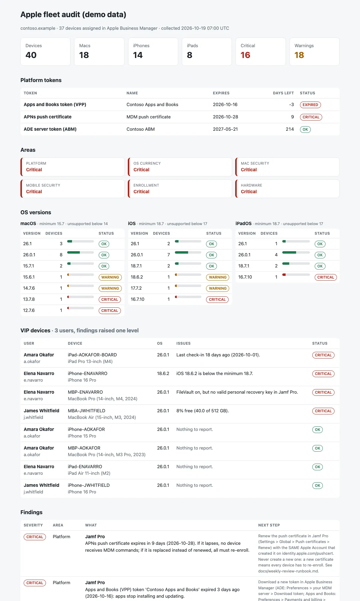

# Apple Fleet Audit

A weekly review of the **Macs, iPhones and iPads managed in Jamf Pro** and enrolled from Apple Business Manager: the push certificate and tokens that keep the whole fleet working, devices on an old or unsupported OS, Macs without FileVault, SIP or a bootstrap token, phones without a passcode, devices that stopped checking in, disks that are full and warranties about to end, with the executives' devices first. One read-only Jamf Pro API export, one Python command, and the answer to: **which Apple devices are not safe, not current or about to drop out of management, and is anything about to break the whole fleet?**

Python 3.10+, standard library only. Read-only Jamf Pro API exporter included. Runs with fictional demo data out of the box.



## Why

Jamf Pro shows every detail of every device, but the weekly questions are spread over smart groups, settings pages and Apple's portals. The same few problems come back:

- the **APNs push certificate** expires and no device gets a command, or someone creates a new one instead of renewing it and **every device has to re-enroll**,
- the **ADE token** expires and new laptops come out of the box unmanaged; the **Apps and Books token** expires and apps stop updating,
- a few devices sit on an **unsupported OS** that no longer gets security fixes,
- a Mac has **FileVault off**, or FileVault on with **no recovery key in Jamf Pro** for the day the user forgets the password,
- an Apple silicon Mac has **no bootstrap token**, so software updates pushed from Jamf Pro never install,
- an iPhone has **no passcode**, an iPad was **enrolled by hand** and the user can remove management,
- a laptop has **not checked in for two months**: lost, wiped or in a drawer,
- the **CEO's iPad** has a full disk the evening before the board meeting.

This tool lists them in one page, ordered by urgency, with the next step for each, a work list per device and a token calendar.

## What it checks

| Area | Checks |
|---|---|
| Platform | APNs push certificate, ADE (Apple Business Manager) server token and Apps and Books (VPP) token: warning at 30 days, critical at 14 days or expired. A token renewed as a second instance for the same ABM server is not reported twice. |
| OS currency | Minimum version per platform (defaults macOS 15.7, iOS 18.7, iPadOS 18.7; `--min-macos`, `--min-ios`, `--min-ipados`): below it is a warning. Major version no longer supported (defaults below macOS 14, iOS 17, iPadOS 17; `--oldest-macos` etc.): critical. Version distribution per platform in the report. |
| Mac security | FileVault off (critical), FileVault on without a valid personal recovery key in Jamf Pro, SIP disabled (critical), Gatekeeper off, firewall off, no bootstrap token on Apple silicon, MDM enrollment not user-approved or not supervised. |
| Mobile security | No passcode (critical), not supervised, managed but not enrolled through ADE (the user can remove the MDM profile). |
| Enrollment | Last check-in or inventory older than 14 days (warning) or 45 days (critical); unmanaged records (clean-up); devices assigned in Apple Business Manager but never enrolled. |
| Hardware | Free storage under 10% (warning) or 5% (critical); warranty or AppleCare ending in 60 days (warning) or ended on a device still in use (clean-up). |
| VIP | Optional `--vip vip.txt` (one username per line). Findings on executives' and board members' devices go up one level (clean-up to warning, warning to critical), are marked "(VIP)" and get their own section. |

A value Jamf Pro did not collect (`null` in the export) skips the check instead of raising a false alarm.

Outputs: `report.html` (single file, light and dark mode), `findings.csv`, `device_actions.csv` (one row per device with all its issues, the owner and the next steps, worst first: a list a technician can work through and tick off) and `review.md` (Act now / This week / Clean-up / Token calendar, ready for the weekly meeting).

How to run the weekly review, renew the APNs certificate safely and renew the ADE and VPP tokens in Jamf Pro: [docs/weekly-review-runbook.md](docs/weekly-review-runbook.md). Export format: [docs/export-schema.md](docs/export-schema.md).

## Try it

```bash
git clone https://github.com/inigogonzalezgarcia/21-apple-fleet-audit.git
cd 21-apple-fleet-audit
python -m applefleet demo
```

Open `output/report.html`, `output/device_actions.csv` and `output/review.md`.

The demo is a made-up fleet (`contoso.example`) of 40 devices: 18 Macs (Apple silicon and Intel), 14 iPhones and 8 iPads, with three VIP users. People, serial numbers and dates are invented. Faults are placed on purpose: an APNs certificate that expires in 9 days, an Apps and Books token that expired 3 days ago (the ADE token is fine), a Mac with FileVault off, an executive's Mac with no recovery key escrowed, a developer Mac with SIP disabled, an Apple silicon Mac without a bootstrap token, Macs, an iPhone and an iPad on unsupported versions, an iPhone without a passcode, an unsupervised iPad, a laptop not seen for 60 days, a Mac with 4% free storage, warranties about to end, an unmanaged record and an iPad assigned in Apple Business Manager that was never enrolled.

## Use it with your own Jamf Pro

1. In Jamf Pro, **Settings > System > API roles and clients**: create an API role with read privileges only (**Read Computers**, **Read Mobile Devices**, **Read Device Enrollment Program Instances**, **Read Volume Purchasing Locations**) and an API client with that role. Generate a client secret and keep it in your password manager.
2. Export. The secret is read from the `JAMF_CLIENT_SECRET` environment variable, never from the command line:
   ```bash
   export JAMF_CLIENT_SECRET='...'
   python -m applefleet export --url https://yourorg.jamfcloud.com --client-id <client-id> --out jamf_inventory.json
   ```
   It calls `POST /api/oauth/token` (client credentials), then `GET /api/v1/computers-inventory` (sections general, hardware, operating system, security, disk encryption, storage, user and location, purchasing), `GET /api/v2/mobile-devices/detail` (or the device list plus per-device detail on versions without it), `GET /api/v1/device-enrollments` with the devices of each instance, and `GET /api/v1/volume-purchasing-locations`, with `page` / `page-size` paging. Nothing is written to Jamf Pro.
3. Build the outputs. The APNs expiry is not read from the API (it is not available in every version); take it from **Settings > Global > Push certificates**:
   ```bash
   python -m applefleet report jamf_inventory.json --vip vip.txt --apns-expires 2027-03-01 --out output
   ```
   Options: `--min-macos 15.7`, `--min-ios 18.7`, `--min-ipados 18.7`, `--oldest-macos 14`, `--oldest-ios 17`, `--oldest-ipados 17`, `--token-warning-days 30`, `--token-critical-days 14`, `--stale-days 14`, `--lost-days 45`, `--title "CONTOSO · Apple fleet"`.

**The exporter has not been tested against a real Jamf Pro instance yet.** Endpoints and field names follow the public Jamf Pro API documentation and every field is read defensively (a missing field becomes `null` and its check is skipped). The mapping from each Jamf Pro field to the export is in [docs/export-schema.md](docs/export-schema.md).

The export and the reports contain serial numbers, device names and usernames. Keep them inside your organisation. Real exports and VIP lists (`jamf_inventory*.json`, `vip*.txt` at the top level) and the `output/` folder are excluded from Git by `.gitignore`; only the fictional files in `sample_data/` are committed.

## Tests

```bash
python -m unittest discover tests      # or: pip install -r requirements-dev.txt && python -m pytest
```

17 tests: a clean fleet with no findings; token thresholds (31, 30, 14 days, expired, no APNs date), a token renewed as a second instance for the same ABM server and an APNs date typed after renewal; OS version comparison (14.10 above 14.9, 17.7.2 above 17.7, 26 above 15, Rapid Security Response suffixes); minimum version vs unsupported major; FileVault and recovery key; SIP, Gatekeeper and firewall; bootstrap token only on Apple silicon, and MDM approval; values not collected skip the check; passcode, supervision and ADE on mobile; check-in thresholds and unmanaged records; devices assigned in ABM but never enrolled; storage and warranty thresholds; VIP bumping and the per-device work list; the exporter against small Jamf Pro API fixtures (OAuth request, paging over two pages, normalisation of computers, mobile devices, ADE and VPP) and its fallback to per-device mobile detail; and the demo end to end (every check fires at least once, all outputs written).

**What has not been tested yet:**

- the exporter against a real Jamf Pro instance (only against fixtures written from the API documentation),
- reading the APNs expiry through the API (it is a command-line value for now),
- Apple Business Manager data as Jamf Pro returns it (`/device-enrollments/{id}/devices`, profile statuses, how removed devices appear).

## Background

Built from my work managing MacBooks, iPhones and iPads with Jamf Pro and supporting executive and VIP users. Written from scratch with fictional data; no employer scripts, data or configuration are used.

## Customisation and contact

Want this adapted to your fleet (your own OS baselines, Teams or email alerts, a scheduled run, smart groups or an Intune version)? Get in touch:

- Website (contact form): [inigogonzalezgarcia.github.io](https://inigogonzalezgarcia.github.io/about.html#contacto)
- LinkedIn: [linkedin.com/in/igonzalez93](https://www.linkedin.com/in/igonzalez93)

## License

MIT
